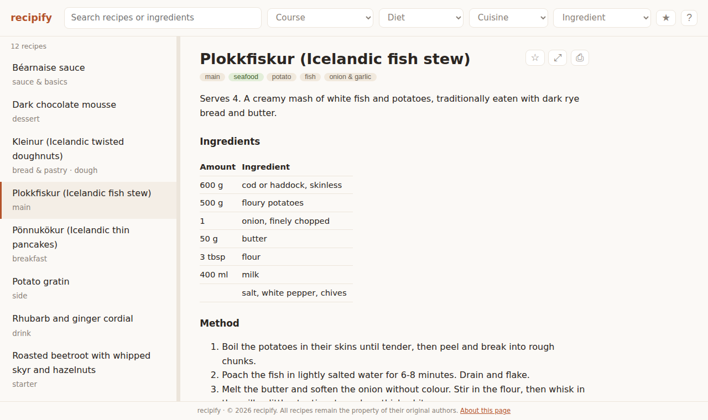
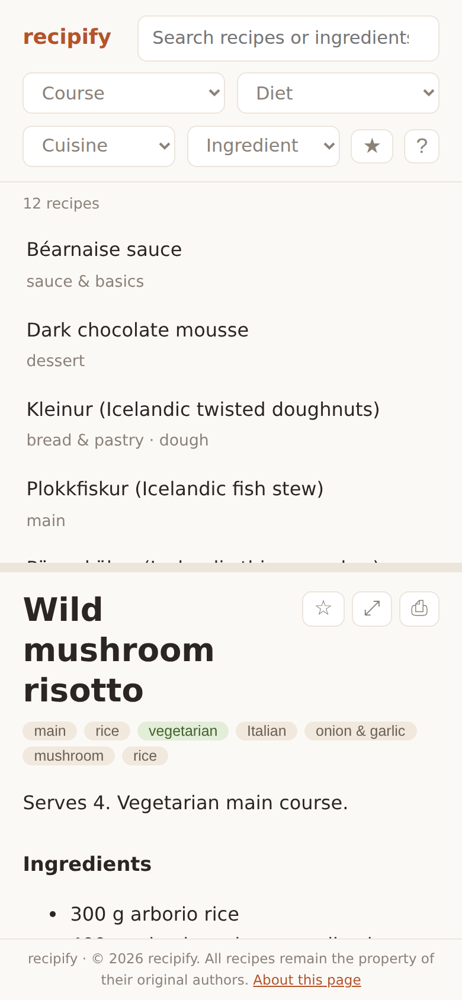
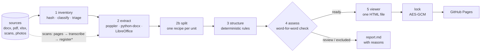

# recipify

[](https://github.com/steinnhauser/recipify/actions/workflows/ci.yml)
[](https://steinnhm.com/recipify/coverage/)
[](pyproject.toml)
[](LICENSE)

**A document-processing pipeline that turns a kitchen's archive of recipe files into verified, structured recipes, and publishes them as one offline HTML file that chefs can cook from.**

recipify started from a real archive: about 1,900 files collected over many years by a professional kitchen, mostly in Icelandic. It holds Word documents, PDFs exported from Word (often laid out in two or three columns), scanned notebooks, photos, spreadsheets, cookbooks, menus, cleaning plans and many copies of the same files. Out of that archive, recipify publishes **508 recipes that were checked word for word against their source documents**, including recipes split out of 15 documents that each held several (Word collections, a recipe book, recipe spreadsheets). It holds back everything it can't check yet, and the report says why for each document.

**[Live demo](https://steinnhm.com/recipify/demo/)**: the whole pipeline run in CI on the [sample documents](examples/sources) ([pipeline report](https://steinnhm.com/recipify/demo/report.md))

<p align="center">
  
  &nbsp;
  
</p>

## The pipeline



<sub>\* scans and photos have no text layer: their page images are transcribed outside the pipeline (by hand or with a vision model) and stored as versioned, never-overwritten artifacts</sub>

| Stage | What it does | Stored as |
| --- | --- | --- |
| **1 Inventory** | Hashes every file, classifies it by its content rather than its extension (a `.pdf` can be a Word file or an EPUB), merges identical copies and triages each document as a recipe, a book (EPUB, or more than 8 pages) or reference material (mise en place lists, menus, staff rules). | `inventory.json` |
| **2 Extract** | Gets the text out locally and for free. PDFs use poppler in content-stream order, so each component of a multi-column recipe stays together, and the result is cross-checked against poppler's layout rendering. Word documents are read from the XML, including the text boxes that python-docx skips. Spreadsheets are read sheet by sheet, each block of columns top to bottom, so recipes laid out side by side don't mix. Scans get a transcription through `pages` and `register`. | `extractions/<sha256>/<engine>@v<N>.json` |
| **2b Split** | Splits a document that holds several recipes (a confectionery or cake collection, a recipe book, a workbook with one recipe per sheet) at its page breaks or sheets, one recipe per unit. A cover, a table of contents and section headings are set aside. It only splits clear cases: the document must be named as a collection, every recipe must start on its own titled page, and the parts must not be translations of each other. A plated dish whose components fill several pages stays whole. Every decision, split or not, is stored with its reason. | `splits/<sha256>/<extraction>/pages@v<N>.json` |
| **3 Structure** | Splits the text into components (a sauce, a crumble, a dough), each with its ingredients, method steps and notes, and parses quantities so they can be scaled. Deterministic rules do this, so the same text always gives the same recipe. | `recipes/<unit sha256>/<engine>@v<N>.json` |
| **4 Assess** | Counts every word and number in the extracted text and in the structured recipe, and checks them against each other. It also checks reading order, garbled text, whether there is an ingredient list and a method, and how long the document is. A document is `ready` only when every check passes. | `catalog.json`, `report.md` |
| **5 Publish** | Builds one self-contained HTML file from the `ready` recipes, and optionally encrypts it for public hosting. | `dist/index.html`, `site/index.html` |

### Why it can be trusted

- **Nothing is rewritten.** The structurer only decides what each source line is: a component name, an ingredient, a step or a note. It never changes the text. The few lines it leaves out on purpose (a repeated title, step numbers the viewer draws itself) are listed in the artifact.
- **Every published recipe is proven complete.** For text-layer documents the extracted text *is* the document. Recall 1.0 (every source word is shown) and precision 1.0 (no word was added) mean the reader sees exactly what the original says, only easier to follow. A paraphrase or an "improved" quantity would send the recipe to review instead of into the app.
- **Two extractors must agree on reading order.** A PDF whose text order doesn't match its visual layout is held back, even if every word is present.
- **Hard cases are named, not hidden.** [`report.md`](https://steinnhm.com/recipify/demo/report.md) lists every document that is not ready, with the reason.

### Why it is cheap to re-run

- Every artifact is keyed by the source's SHA-256 and the engine's version. Re-running the pipeline skips everything that is already done, renamed files keep their results, and an interrupted run resumes where it stopped.
- A new engine version writes a new file beside the old one, so earlier results are never overwritten.
- Transcriptions of scans are never overwritten: a second transcription of the same document is stored as the next version. Duplicates share one result.
- Every catalog run saves each recipe's tier in `history/`, and `report.md` lists what changed since the previous run.

### Why every recipe can be traced

`recipify trace` follows a published recipe back to the file it came from, and re-checks every link on the way:

```text
$ recipify --sources examples/sources trace "Bakery/Kökur - uppskriftir.pdf#2"
  recipe     'Hjónabandssæla'  id 35758add8c82-2  tier ready
✓ structured rules@v1 from unit 2          data/recipes/488b8748…/rules@v1.json
✓ unit       recipe 2 of 2, page(s) 2
  split      pages@v1: split: 2 recipes, each starting on a new page with its own title
✓ extraction poppler@v2                    data/extractions/35758add…/poppler@v2.json
✓ source     Bakery/Kökur - uppskriftir.pdf  sha256 35758add8c821511…
```

A recipe's ID is its source's SHA-256 prefix, plus `-<n>` when it was split from a collection. Its footer in the viewer names the original file and page.
- On the real archive, a full free run takes about 16 seconds once the files have been hashed.

### Results on the real archive

| | Documents |
| --- | ---: |
| Source files | 1,916 |
| Unique documents (byte-identical copies merged) | 930 |
| Recipes, after splitting 15 collections into 248 recipes | 1,163 |
| **Ready**: verified, structured and published | **508** |
| Review: converted, but a check failed (no clear ingredient list, uncertain reading order, transcribed from images, ingredient formulas without a method) | 135 |
| Waiting for a transcription (photographed recipe pages) | 18 |
| Photos of plated dishes | 304 |
| Not recipes, or not yet: books, course material, menus, costing sheets and other paperwork, PDF twins of Word files, older copies of the same recipe | 198 |

## The viewer

The viewer is one HTML file with no external requests, so it works offline and can be emailed.

- **Recipes in components:** each component lists its quantities in an aligned column next to numbered steps. The source's own labels ("Aðferð", "Hráefni") are kept as headings.
- **Built for cooking:** scale ½× to 4× (baker's percentages stay as they are), tick off ingredients and steps, and switch to a full-screen reading view on phones. Recipes can also be printed.
- **Finding recipes:** search that ignores accents, filters with live counts, and course, diet, cuisine and main-ingredient labels detected with [transparent keyword rules](src/recipify/labels.py). Favourites and notes are saved in the browser.
- **Grows with you:** an editable page (`build --editable`, the demo, and `recipify starter`) lets anyone add, edit and remove recipes in the browser and **Export** the result as a new file of the same kind, named as they like (`.html` is always added). Unsaved changes survive a reload, an edited recipe says it was edited by hand and is no longer marked as checked, and unchanged recipes are copied byte for byte. Private collections are built without it, since an export would be an unencrypted copy.
- **Readable without JavaScript:** every recipe is written into the page as plain HTML. iOS Quick Look and mail previews, which don't run scripts, still show the whole collection.
- **Private on a public host:** `recipify lock` encrypts the page (AES-256-GCM, PBKDF2-SHA256), and the key travels in the link's `#fragment`, which browsers never send to the server.

## Quick start

Requires Python 3.12+, [uv](https://docs.astral.sh/uv/) and poppler (`apt install poppler-utils` or `brew install poppler`).

```bash
git clone https://github.com/steinnhauser/recipify.git && cd recipify
uv sync
uv run recipify demo --out demo.html --report report.md   # the whole pipeline on examples/sources
open demo.html
uv run recipify starter recipes.html                      # or: an editable file with two recipes to grow
```

### Your own collection

recipify assumes nothing about your files: drop them into a folder, in any structure and with any names, and run it.

```bash
uv run recipify run path/to/your/recipes      # every stage, then dist/index.html with every ready recipe
uv run recipify show "Desserts/Cheesecake.pdf"  # one recipe: tier, reasons, structured content
uv run recipify trace "Cakes - recipes.pdf#2"  # the second recipe of a split document, back to its file
```

Each stage can also run on its own (`inventory`, `extract`, `split`, `structure`, `catalog`, `build`). Scans and photos are transcribed from their page images, then registered:

```bash
uv run recipify pages "Scans/notebook.pdf" --out pages/       # one JPEG per page
uv run recipify register "Scans/notebook.pdf" --text notebook.md --engine vision --accuracy 0.95
```

A registered transcription goes to `review`, because there is no text layer to check it against. It moves to `ready` once a person has checked it and set its tier in `curation.json`.

Corrections that don't belong in code (a better title, a kind, a tier set after review, a document that must not be split) go in `data/curation.json`. So do words that your collection uses and the defaults don't know: the defaults cover English and Icelandic, and `"vocabulary"` adds to them, for example `{"vocabulary": {"collection_names": ["recettes"], "photo_folders": ["fotos"]}}` ([`vocabulary.py`](src/recipify/vocabulary.py)). Everything under `data/` is git-ignored, so keep one data folder per collection (`--data`).

### Publishing privately

```bash
echo 'ENCRYPTION_KEY="<a long random string>"' >> .env
uv run recipify lock dist/index.html --show-link   # writes site/index.html (only ciphertext), prints the link
```

On `main`, [CI](.github/workflows/ci.yml) refuses to deploy a root page that isn't encrypted. It also checks that the page opens with the `ENCRYPTION_KEY` secret, runs the pipeline on the sample documents for `/demo/`, and publishes the coverage report.

## Project layout

```text
src/recipify/
  cli.py                one command per stage, plus run, show, trace, pages, register, demo and lock
  models.py, store.py   typed stage artifacts (pydantic) and the content-addressed workspace
  pipeline.py           runs the stages: caching, costly-result protection, run log
  classify.py           file categories from content (poppler, zip sniffing, image headers)
  inventory.py          stage 1: hashing, de-duplication, triage
  vocabulary.py         the words that steer triage and splitting (defaults + your additions)
  split.py              stage 2b: one recipe per unit, clear cases only
  trace.py              follows a recipe back to its source, verifying every hash
  extract/              stage 2: pdf (poppler, page images), docx (XML walker), office (LibreOffice, openpyxl)
  structure/            stage 3: rules.py (deterministic parser), quantities.py
  assess.py             stage 4: fidelity check, text quality, language, tiers
  labels.py, report.py  titles, labels and report.md
  viewer.py, lock.py    stage 5: the viewer and its encryption (templates/)
examples/
  recipes/              the sample recipes, written for this project (markdown)
  make_sources.py       turns them into realistic documents in examples/sources/
tests/                  unit tests per stage and an end-to-end run on examples/sources
```

More detail on the design and the checks is in [docs/pipeline.md](docs/pipeline.md).

## Development

```bash
uv sync
uv run pytest --cov                    # 100% line coverage; CI fails below that
uv run pytest -m browser               # the viewer in Chromium (uv run playwright install chromium)
uv run ruff check src tests examples && uv run ruff format --check src tests examples
uv run mypy src                        # strict
uv run pre-commit install              # optional: the same checks before each commit
```

CI runs these on Python 3.12 and 3.13 with poppler installed, and the browser tests in a job of their own.

## License

[MIT](LICENSE). The sample recipes in `examples/` were written for this project. Recipes you process remain the property of their authors.
